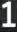
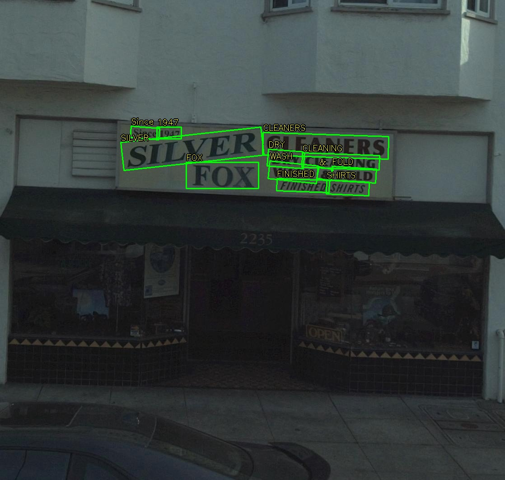
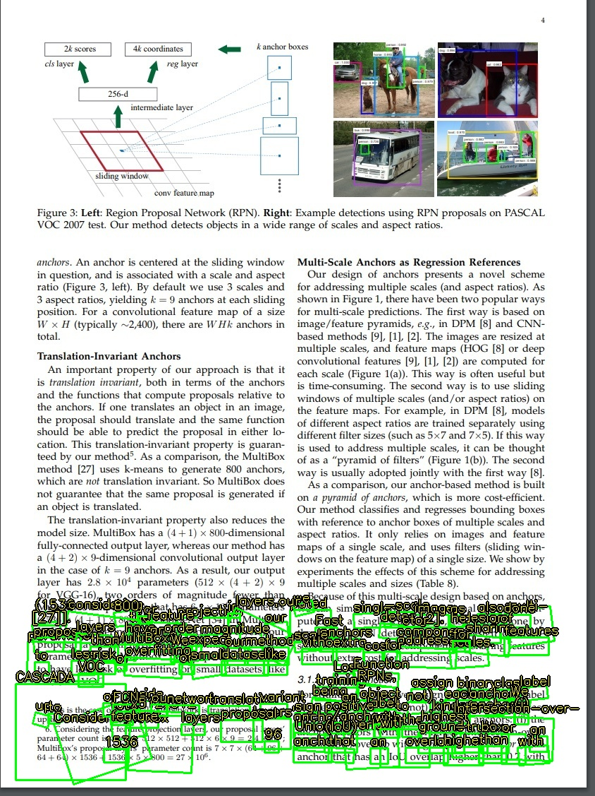
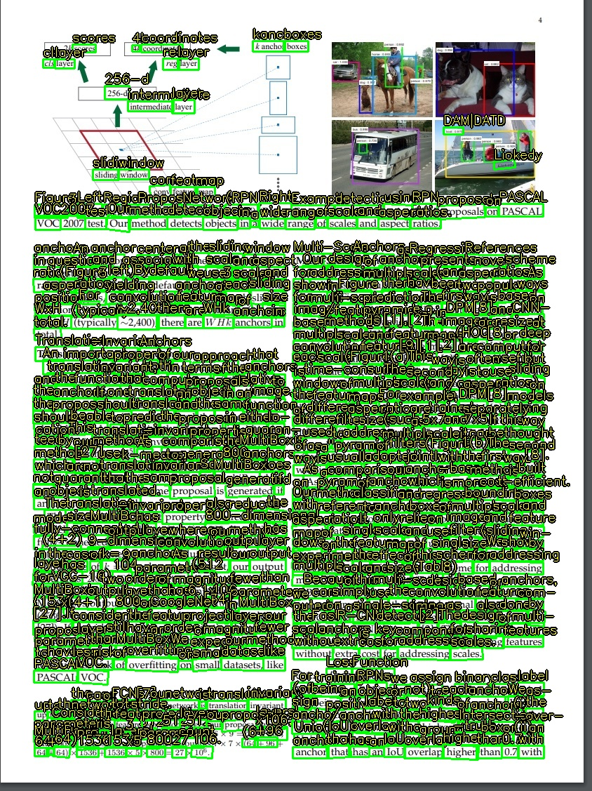

# C++ sample

We provide 2 c++ samples to illustrate the usage of the RADIO-CLIP VL4STR TensorRT engines. You need firstly follow the [Installation](https://github.com/NVIDIA-AI-IOT/NVIDIA-Optical-Character-Detection-and-Recognition-Solution#installation) to prepare the environment to run the following samples.

- [RADIO-CLIP introduction](#radio-clip-introduction)
- [Recognition-only sample](#recognition-only-sample)
- [Detect-crop-recognize sample](#detect-crop-recognize-sample)

## RADIO-CLIP introduction

RADIO-CLIP VL4STR is a scene text recognition model based on [CLIP4STR](https://arxiv.org/abs/2305.14014). It uses a RADIO vision backbone and a SigLIP2 text tokenizer, takes RGB images as network input, and produces sequence output.

The model has two encoder-decoder branches. The visual branch provides an initial prediction based on the visual feature. That prediction is then tokenized and fed to the cross-modal branch, which refines it by addressing the discrepancy between the visual feature and text semantics.

Model dimensions:

| | |
|---|---|
| Input image | 224x224 RGB |
| Image tokens | 196 |
| Feature width | 1536 |
| `text_token` length | 64 |
| Decode steps | 26 |
| Charset | 94 chars |
| Batch | static, 1 |

### Engines

Each branch is split into an encoder and a step-wise decoder, so the 26-step autoregressive loop is driven from the host. This gives 4 engines:

* `{stem}.visual_encode.fp16.engine` — `imgs` → `img_feature`
* `{stem}.visual_decode.fp16.engine` — one decode step
* `{stem}.text_encode.fp16.engine` — SigLIP2 tokens + `img_feature` → `cross_memory`
* `{stem}.text_decode.fp16.engine` — one decode step

The `nvOCDR_init` / `nvOCDR_inference` C API in `include/nvocdr.h` accepts a single OCRNet engine path and has no way to express a 4-engine graph with a host-side decode loop. Both samples therefore call TensorRT directly and do **not** link `libnvocdr.so`.

### Runtime inputs outside the engines

* `pos_queries` are not exported. They are read at runtime from the Lightning checkpoint tensors `visual_decoder.pos_queries` and `cross_decoder.pos_queries` (the sample contains a small zip64 reader for this, as the checkpoint is several GB).
* The SigLIP2 BPE merge table is `c++_samples/siglip2_bpe.bin`. Run the samples from `c++_samples/` or from the repo root.

Both samples hardcode the model locations near the top of the file. Edit these to match your paths:

```c++
const char* kEngineStem =
    "/mnt/data/models/maglev_models/ocrnet09052/deploy/onnx_fp32/vl4str_radioclip_09052_epoch4";
const char* kCheckpoint =
    "/mnt/data/models/maglev_models/ocrnet09052/vl4str_radioclip_epoch4.ckpt";
```

The 94-char charset is compiled into the sample as `kCharset`, so there is no `character_list.txt` to prepare:

```shell
0123456789abcdefghijklmnopqrstuvwxyzABCDEFGHIJKLMNOPQRSTUVWXYZ!"#$%&'()*+,-./:;<=>?@[\]^_`{|}~
```

### Self-test

A tokenizer and `pos_queries` self-test is built into the file and needs no GPU:

```shell
g++ -std=c++17 -DRADIOCLIP_TOKENIZER_TEST ./simple_inference_recognize_radioclip.cpp -I../include -o tok_test
./tok_test
# tokenizer ok
# pos_queries ok
```

## Recognition-only sample

`simple_inference_recognize_radioclip.cpp` is a **pure recognizer**. It resizes the whole input image to 224x224 and recognizes it as a single crop — there is no detection stage.

Use it when the input is already a tight crop of one word or one short text line (an ICDAR15-style crop, or a box cropped by another detector), and to sanity-check the four engines in isolation.

For example 

 

```shell
g++ -std=c++17 ./simple_inference_recognize_radioclip.cpp \
    -I../include -I/usr/include/opencv4/ \
    -I/usr/local/cuda/include -L/usr/local/cuda/lib64 \
    -lnvinfer -lnvinfer_plugin -lcudart \
    -lopencv_core -lopencv_imgcodecs -lopencv_imgproc \
    -o simple_inference_recognize_radioclip
```

```shell
# run sample; the image path is optional and defaults to test_img/1_1.jpg
./simple_inference_recognize_radioclip test_img/1_1.jpg
```

It prints the visual-branch caption, the refined cross-modal text, and the sequence confidence, then writes `<image_path>_v.jpg` with the prediction drawn on it.

> Feeding a full scene or document page to this sample returns a nearly empty string. The 26-step decoder emits at most 26 characters for one text instance, and squashing a multi-word page into 224x224 destroys the aspect ratio of every word. Use the detect-crop-recognize sample for full images.

## Detect-crop-recognize sample

`simple_inference_det_crop_recognize_radioclip.cpp` adds an OCDNet detection stage in front of the recognizer: detect text polygons, perspective-warp each one to an upright crop, then run the 4-engine recognition chain per crop.

Detection lives in the header-only `ocdnet_detector.h` (namespace `ocd`), which talks to TensorRT and OpenCV directly. Its preprocessing reproduces `nhwc2nchwWithMeanScaleResize` from `src/kernel.cu`, and its post-processing reproduces `OCDNetEngine::postprocess`, `findCoutourWarp`, `unclip` from `src/OCDNetEngine.cpp` plus the corner ordering in `RectEngine::formatPoints` from `src/RectEngine.cpp`. It is independent of `libnvocdr.so`, so the sample still builds with plain `g++`; the library's internal `src/OCDNetEngine.h` cannot be used here because it includes `src/kernel.h`, which contains `__host__ __device__` code and requires `nvcc`.

Prepare an OCDNet engine as described in the top-level [Installation](https://github.com/NVIDIA-AI-IOT/NVIDIA-Optical-Character-Detection-and-Recognition-Solution#installation):

```shell
wget --content-disposition 'https://api.ngc.nvidia.com/v2/models/org/nvidia/team/tao/ocdnet/deployable_v1.0/files?redirect=true&path=dcn_resnet18.onnx' -O dcn_resnet18.onnx
mv dcn_resnet18.onnx ocdnet.onnx

/usr/src/tensorrt/bin/trtexec --onnx=./ocdnet.onnx \
    --minShapes=input:1x3x736x1280 \
    --optShapes=input:1x3x736x1280 \
    --maxShapes=input:4x3x736x1280 \
    --fp16 --saveEngine=./ocdnet.fp16.engine
```


Compile — note the extra `-I.` so `ocdnet_detector.h` is found, and `-lopencv_highgui`:

```shell
g++ -std=c++17 ./simple_inference_det_crop_recognize_radioclip.cpp \
    -I../include -I. -I/usr/include/opencv4/ \
    -I/usr/local/cuda/include -L/usr/local/cuda/lib64 \
    -lnvinfer -lnvinfer_plugin -lcudart \
    -lopencv_core -lopencv_imgcodecs -lopencv_imgproc -lopencv_highgui \
    -o simple_inference_det_crop_recognize_radioclip
```

```shell
# run sample
export NVOCDR_OCD_ENGINE=/path/to/ocdnet.fp16.engine
./simple_inference_det_crop_recognize_radioclip test_img/nvocdr.jpg
```

One line is printed per detected region — index, refined text, confidence, the visual-branch caption, and the crop size — and `<image_path>_v.jpg` is written with every polygon and its text drawn on it.



If detection returns no polygons, the sample falls back to recognizing the whole frame, which is the recognition-only behaviour.

Detection and cropping are tunable at runtime, so no recompile is needed while tuning:

| Variable | Default | Meaning |
|---|---|---|
| `NVOCDR_OCD_ENGINE` | path in `kOcdEngineDefault` | OCDNet engine to load |
| `NVOCDR_BINARIZE` | `0.1` | Probability-map binarize threshold |
| `NVOCDR_POLYGON` | `0.3` | Minimum mean score per contour |
| `NVOCDR_UNCLIP` | `1.5` | Box dilation ratio |
| `NVOCDR_MAX_CANDIDATES` | `5000` | Max candidate contours kept, ranked by score |
| `NVOCDR_EXPAND` | `0.05` | Extra margin added around each crop |
| `NVOCDR_ROTATE` | `0.0` | Aspect-ratio threshold below which a box is rotated 90 degrees; raise to about `1.0` for vertical text |
| `NVOCDR_TILE_OVERLAP` | `0.0` | `0` = single pass; `>0` = overlapped tiled detection (see below) |
| `NVOCDR_DUMP_CROPS` | unset | Directory to write every crop as `crop_<i>.png` |
| `NVOCDR_DUMP_MASK` | unset | Directory to write the probability map as `mask_<mode>.png`, plus its size and value range |

These mirror `ocdnet_binarize_threshold`, `ocdnet_polygon_threshold`, `ocdnet_unclip_ratio`, `ocdnet_max_candidate` and the rectifier's `rotation_threshold` in `nvOCDRParam`.

Candidates are ranked by contour score before `NVOCDR_MAX_CANDIDATES` is applied, so if the cap binds you lose the lowest-confidence regions rather than whichever ones `findContours` happened to reach first. The sample reports the counts, and flags the cap when it binds.

### Tiled detection for dense pages

By default the detector resizes the whole image to the engine's input resolution in one pass — the behaviour of `nvOCDR_inference`. On a high-resolution document that downscales small text until OCDNet can no longer see it.



Setting `NVOCDR_TILE_OVERLAP` switches to overlapped tiling, which reproduces the **detection half** of `nvOCDR_high_resolution_inference(input, &output, nvocdr_ptr, 0.5)`:

```shell
export NVOCDR_OCD_ENGINE=/path/to/ocdnet_320.fp16.engine
export NVOCDR_TILE_OVERLAP=0.5
./simple_inference_det_crop_recognize_radioclip test_img/doc.jpg
```




`0.5` is the same `overlap_rate` that `crop_based_inference.cpp` passes. Use it with a smaller OCDNet engine (`320x320`), exactly as the crop-based nvOCDR sample does:

```shell
/usr/src/tensorrt/bin/trtexec --onnx=./ocdnet.onnx \
    --minShapes=input:1x3x320x320 \
    --optShapes=input:1x3x320x320 \
    --maxShapes=input:1x3x320x320 \
    --fp16 --saveEngine=./ocdnet_320.fp16.engine
```

What happens per call:

1. The image is resized aspect-preserving onto a tile-aligned canvas (zero-padded).
2. The canvas is cut into tiles at the engine's input resolution, stepping by `tile - overlap`.
3. Each tile is inferred at native resolution; tiles that fall entirely in the padding are skipped.
4. The probability maps are stitched into one full-canvas mask — each tile contributes only its centre, with half the overlap trimmed off every inner edge.
5. Contours are found **once** on the merged mask, so a text line crossing a tile seam stays a single box.

The merged-mask step is why this beats running the detector on crops independently.

Cost scales with tile count instead of 1, so reserve it for pages where single-pass misses text. Recognition still runs once per detected box either way.

Two notes if you compare against the library:

* `nvOCDR::wrapInferPatch` reads `ocdnet_infer_input_shape[1]` for both patch height *and* width (`src/nvOCDR.cpp:711-712`), so a non-square engine tiles with square patches. `ocd::Detector` takes both dimensions from the engine's real input shape.
* The library's merged-mask buffers are allocated without being zeroed (`src/nvOCDR.cpp:478-479`), and a single-column or single-row grid still trims half the overlap off its outer edge, leaving part of the mask never written. `ocd::Detector` zeroes the canvas and keeps outer edges, so the tile keep-regions cover the canvas exactly once.

Tuning notes:

* Too few boxes on a dense page — set `NVOCDR_TILE_OVERLAP=0.5` with a `320x320` engine before touching thresholds.
* Too few boxes — lower `NVOCDR_BINARIZE` to about `0.05`, or `NVOCDR_POLYGON` to about `0.2`.
* Boxes clipping characters — raise `NVOCDR_UNCLIP` to `1.8`–`2.0` and `NVOCDR_EXPAND` to `0.10`.
* Still-empty predictions — set `NVOCDR_DUMP_CROPS` and inspect the crops. If the crops look correct, the problem is in the recognition engines rather than detection; run the `-DRADIOCLIP_TOKENIZER_TEST` build to rule out the tokenizer and `pos_queries` first.
* Boxes clustered in one part of the image — check the `contours:` line for `CAP HIT` and raise `NVOCDR_MAX_CANDIDATES`. If the cap is not binding, set `NVOCDR_DUMP_MASK` and look at `mask_tiled.png` / `mask_single.png`. A clean mask with bad boxes means the map-to-image scale factor is wrong; a mask that is itself bright along one edge means detection is firing on the content/padding border.
